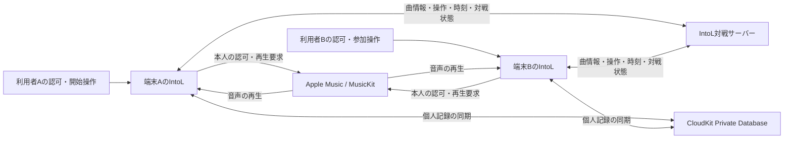

# AppleへのMusicKit利用・収益化問い合わせ案

作成日：2026年10月17日。未送信。送信前に運営者・Bundle ID・動画・広告配置・料金案を最終確認する。

## 添付するもの

- ソロ出題、PUSH停止、正解発表、復習、対戦を示す実際の操作動画。
- 音声は各端末のMusicKitから再生し、サーバーでは配信・保存しないことを示す構成図。
- 広告が出る画面と、広告削除購入前後の差分。
- 紹介目的の説明と、実際の早押し・得点・ランク等の機能説明。
- 独立した音源利用・外部データの許諾状況。未確認事項は未確認と記載する。

## 再生・通信の構成

端末A・Bの利用者はそれぞれApple Musicの再生条件を満たす。CloudKitの個人記録は各利用者のApple Accountごとに分かれ、対戦参加者で共有するデータベースではない。サーバーとCloudKitにはApple Musicの音声ファイルを保存しない。

## English draft

Subject: Guidance on MusicKit playback integration and a proposed advertising / ad-removal model

Hello Apple Developer Support / App Review,

We are preparing IntoL, an iPhone app, for App Store distribution. Its purpose is to help people discover songs, become familiar with music, and revisit songs they would like to remember.

The app also has quiz-like interactions, including timed intro questions, a buzzer, scores, rank measurement, and private multiplayer rooms. We would like guidance based on these actual behaviors rather than relying on the app's stated purpose or category.

Each participant grants MusicKit authorization and must independently have the capability to play Apple Music catalog content. Apple Music audio is played by ApplicationMusicPlayer on each user's device. Our server exchanges song metadata, room state, and timing information; it does not download, store, or redistribute Apple Music audio.

After the user starts a session, the app plays a song intro for up to 30 seconds. Playback can stop when the user presses the buzzer or when the question ends. During the answer reveal, the app seeks to a position based on a chorus-position database or the song duration. A review screen allows full-song playback and seeking. We are removing preview-audio fallbacks from that review screen.

We are considering a free download supported by advertising and an optional, one-time non-consumable purchase that removes advertising. The purchase would not unlock Apple Music playback, additional Apple Music songs, higher-quality audio, or a gameplay advantage. The initial advertising proposal is a banner on the session-results screen, with no reward ads that unlock playback and no ads during multiplayer questions. No advertising network has been selected. Advertising and purchases are currently disabled.

We understand that Guideline 4.5.2 and the Developer Program License Agreement prohibit requiring payment for, or indirectly monetizing, access to the Apple Music service. We are not assuming that a music-discovery or educational purpose creates an exception.

Could you please clarify:

1. Whether this proposed placement and ad-removal purchase would be considered indirect monetization of access to Apple Music, and what changes would be necessary if so.
2. Whether the timed questions, automatic transitions, buzzer-triggered stopping, seeking for answer reveals, and multiplayer timing are compatible with the MusicKit requirements for user-initiated playback, full-song availability, and standard media controls.
3. Which aspects of this integration require separately securing permissions and assets from music rights holders, and which additional documentation we should provide for review.
4. Whether there are additional requirements for the use of artwork and song metadata in the review screen and App Store screenshots depicting the app's functionality.

We can provide recordings of the flows, a playback architecture diagram, proposed ad placement, and the exact scope of the in-app purchase. We understand that any pre-submission guidance does not guarantee approval of a submitted app or replace permissions from rights holders.

Thank you.

## 回答後の判断記録

- 回答日・問い合わせ番号：未取得
- 提示した動画・仕様の版：未確定
- 広告・課金の可否と条件：未確認
- 再生制御の修正事項：未確認
- 別途許諾・提出資料：未確認
- 次の実装に反映する内容：未確定
